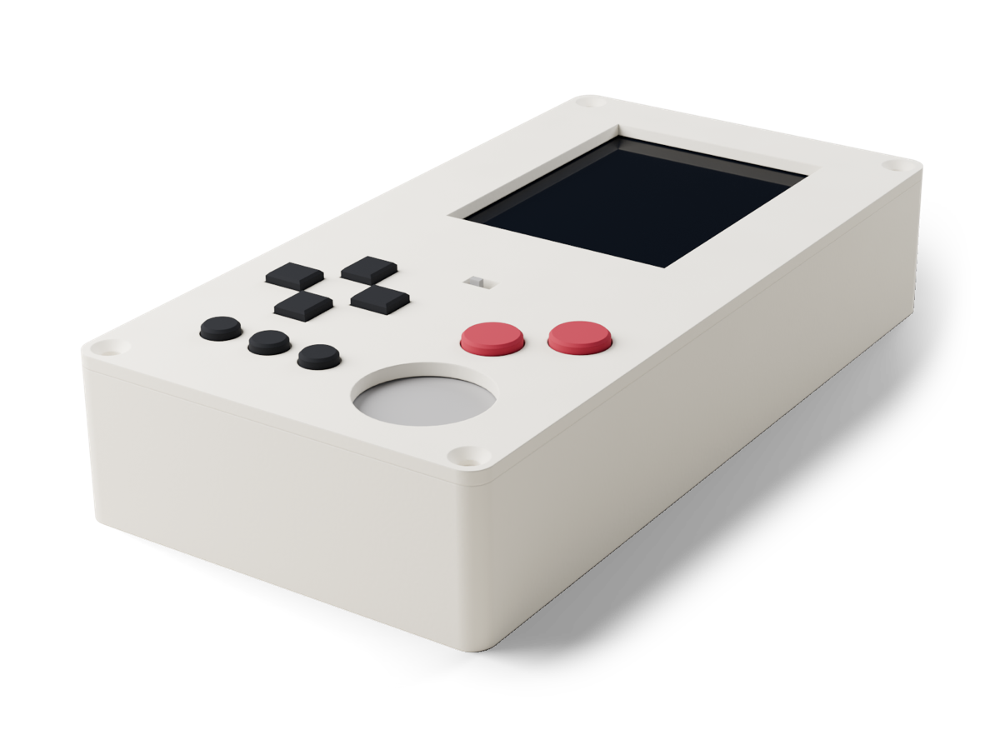
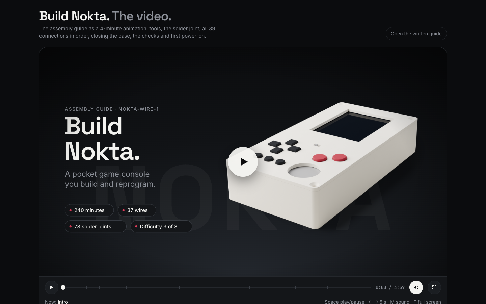
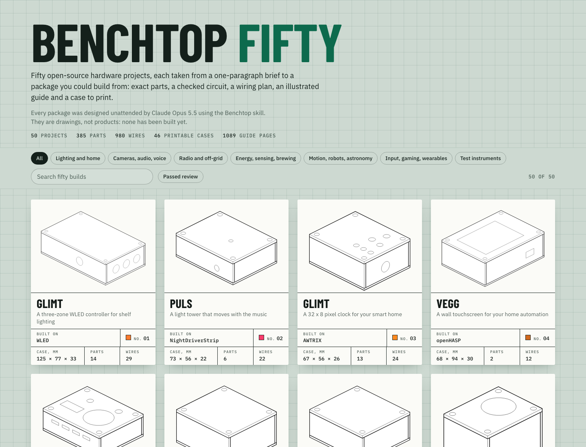
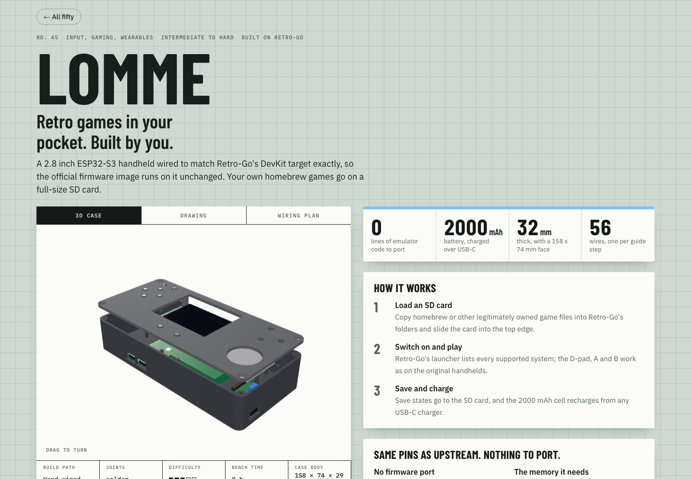
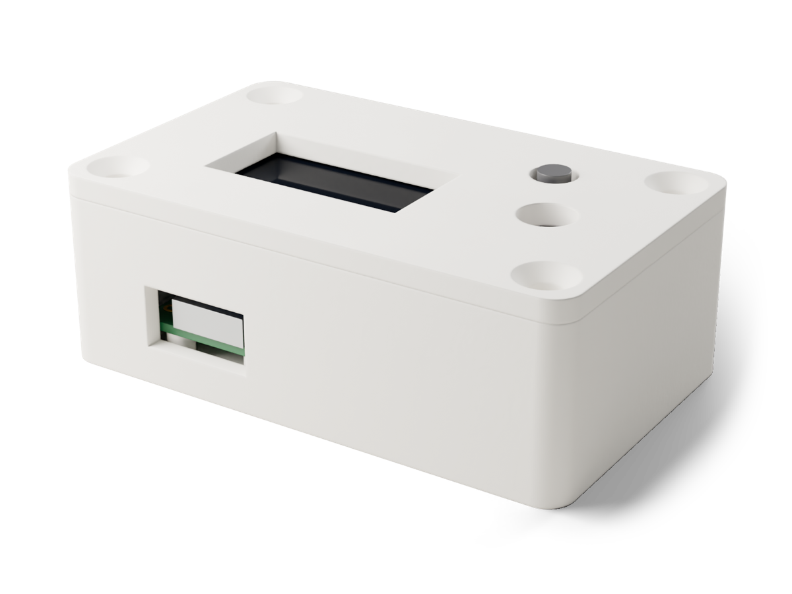

# Benchtop

Build packages for microcontroller and 3D-printing projects, generated from a short description.

<p align="center">
  <a href="https://filipjaj.github.io/benchtop/nokta/"></a>
</p>

<p align="center">
  <a href="https://filipjaj.github.io/benchtop/"><b>Website</b></a> ·
  <a href="https://filipjaj.github.io/benchtop/nokta/video/"><b>Build video</b></a> ·
  <a href="https://filipjaj.github.io/benchtop/fifty/"><b>Fifty example projects</b></a> ·
  <a href="#install"><b>Install</b></a>
</p>

A Claude Code skill that takes a microcontroller or 3D-printing project from "I want a
thing that..." to a folder someone can build from:

- a concept sheet with closed and inside views, size and cost
- a checked circuit (24 electrical rules) and a wiring plan drawn to scale from the part files
- a flat-pack-style illustrated build guide, one step per wire (HTML and PDF)
- a parts list and a shopping page with region-aware shop searches
- a 3D-printable case (STL and 3MF) plus a fit-test print
- an optional carrier PCB
- a firmware scaffold with a generated pin map and a bring-up test (ESP32, RP2040, AVR)
- renders, dimensioned drawings and a landing page that links every file

Everything is generated from one `project.json`, so the guide, the firmware pins and the
case cannot disagree with each other.

## Examples

### Nokta, a game console

A pocket console with a 2.8 inch screen, a D-pad, seven games and a USB-charged battery.
The package includes a four-minute animated build video generated from the same guide.

<a href="https://filipjaj.github.io/benchtop/nokta/video/"></a>

[Package](https://filipjaj.github.io/benchtop/nokta/) ·
[Build video](https://filipjaj.github.io/benchtop/nokta/video/) ·
[Guide](https://filipjaj.github.io/benchtop/nokta/guide/)

### Benchtop Fifty

Fifty real open-source hardware projects (WLED, Meshtastic, ZMK, Retro-Go, GP2040-CE and
more), each designed by the skill from a one-paragraph brief with no one at the keyboard.
Each has a wiring plan and an illustrated guide; 46 have a printable case you can rotate in 3D.

| | |
| --- | --- |
| <a href="https://filipjaj.github.io/benchtop/fifty/"></a> | <a href="https://filipjaj.github.io/benchtop/fifty/#p45"></a> |

[Browse all fifty](https://filipjaj.github.io/benchtop/fifty/)

### Luft, a first build

<a href="https://filipjaj.github.io/benchtop/luft/"></a>

A desk air monitor that shows temperature, humidity and pressure on a small OLED. Four
parts, about an hour to build. [Package](https://filipjaj.github.io/benchtop/luft/) ·
[Download the kit](https://filipjaj.github.io/benchtop/luft/luft.zip)

<br clear="right">

## Status

Version 0.1, alpha. The outputs are checked by software on every build (closed meshes,
electrical rules, drawing checks, firmware compiles, 680+ tests), and evaluated on 50
projects across models. **Nothing has yet been printed, soldered or flashed from a
Benchtop package.** Treat the first build of any design as a prototype: print the fit
test, check parts against the "must match" notes before you buy, and measure clone
modules (they vary between sellers).

Known limits: rectangular two-piece cases only; one controller per project; power
checks do not follow current through switches or chargers; wire lengths are not
computed; dense 3 x N servo headers do not lay out cleanly in the wiring plan.

Model: Claude Sonnet 5.5 gives the same results as Opus at under half the cost in our
trials. Haiku needs a person to finish the guide.

## Install

In Claude Code:

```
/plugin marketplace add filipjaj/benchtop
/plugin install benchtop@benchtop
```

Then describe what you want to build. The skill asks before each phase.

### Requirements

| For | Needs |
| --- | --- |
| Everything | [bun](https://bun.sh) |
| Case and PCB | `bun install --cwd skills/benchtop/scripts` (the skill asks first) |
| PDF guide, screenshots | Chrome, Chromium or Edge |
| Compiling firmware | PlatformIO |
| 3D renders | Blender on `PATH` |

Each is optional: without it, that one output is skipped and the package says so.

## Parts catalog

`skills/benchtop/assets/catalog/maker_catalog.sqlite` holds 636 parts with the dimensions,
pins and pad positions their manufacturers published, each value linked to its source.
It contains no shop data, prices, copied text, images or CAD files.
`skills/benchtop/references/catalog.md` explains how to use it and how it is built.

## Licence

Code: MIT. Parts catalog: CC BY 4.0. See [LICENSE](LICENSE).
